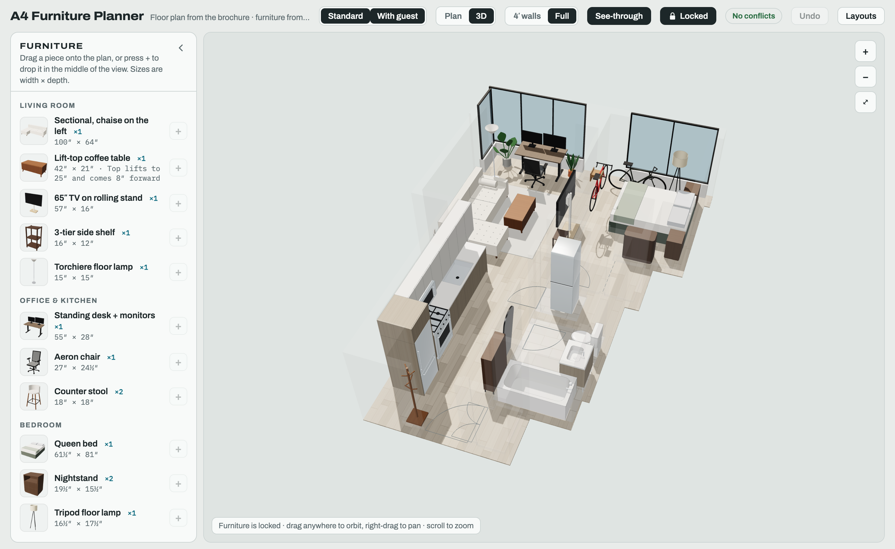

# Apartment furniture planner

A drag-and-drop furniture planner for one apartment, in a plan view and a 3D view, built from the
brochure plan (and, where you have them, tape measurements). Everything is generated from Python: the floor
plan, every piece of furniture, and the page itself (`web/index.html`, one self-contained file). The same
geometry also comes out as 3D-printable STLs at 1:60.

This repo is Residence A4 at Loden, Brooklyn (1 bed / 1 bath, 546 SF) and its furniture as an example. Fork it
and swap in your own place. The furniture was read off a walkthrough video of the owner's current apartment,
so its sizes are estimates until measured.

## Try it

Open `web/index.html` in a browser (three.js and the fonts load from CDNs; the rest is inside the file).
To share it, turn on GitHub Pages for your fork (Settings → Pages → deploy from the `main` branch, root
folder) and open `https://<you>.github.io/<repo>/web/`.

- Drag furniture in from the list; drag to move, R / Shift+R to rotate, F (or double-click) to switch
  two-state pieces (the lift-top coffee table), Delete to remove,
  Ctrl/Cmd+Z to undo.
- **Lock** freezes the furniture so dragging only moves the camera. **See-through** makes the walls
  translucent. **Standard / With guest** switch between the two layouts built into the page.
- Red = overlapping a wall or another piece; amber = blocking a door swing. Selecting a piece shows its
  clearance to the nearest wall or piece in each direction.
- **Layouts** saves layouts in your browser and shares them as a text "layout code" anyone can paste in.
  (The page was built as a Claude artifact, where it can also share saved layouts between visitors through a
  database. On GitHub Pages or from a file, those features stay off and everything else works.)

## Make it your own

Install the dependencies once: `python3 -m pip install -r requirements.txt`.

1. **Floor plan: `floorplan.py`.** All units are real inches; x runs east, y runs south.
   - Every wall face is a named line. Its position comes from a dimension (`MEAS`: "from line a to
     line b is N inches", here the room sizes printed on the brochure) or, for unmeasured lines, from pixel
     positions on an image of the plan (`PX_X` / `PX_Y`), scaled by the px-per-inch the dimensions calibrate.
     `solve()` places them, interpolating unmeasured lines between the nearest measured ones.
   - `WALLS`, `WINDOWS`, `DOORS` (hinged, with swing), `SLIDERS`, `FIXTURES` (kitchen, baths) and `ROOMS`
     are lists of rectangles between those lines.
   - For a new place, the simplest start is to replace those lines and lists with your own: measure the
     rooms, name the wall faces, and list them. The pixel photo is optional; with enough measurements you
     can place every line from `MEAS` alone.
   - Check it with `python3 build.py`: it writes a dimensioned plan (`output/plan-dimensions.png`), 3D
     previews and the printable STLs to `output/`.
2. **Furniture: `furniture.py`.** `FURNITURE` holds each piece's real dimensions in inches; a builder
   function turns them into a solid (boxes, cylinders and hulls with manifold3d), registered in `BUILDERS`.
   Pieces built with `parts=True` return colored parts for the website. Add new pieces to `WEB_ONLY` if you
   don't want to print them.
3. **Website list: `web/export_web.py`.** `PIECES` gives each piece its name, group and color(s);
   `EXAMPLE` is the starting layout (plan inches; rotation 0 = front faces south). Collisions use each
   piece's footprint rectangle; `FOOTPRINTS` in `furniture.py` overrides it (one rectangle per leg for the
   L-shaped sectional, just the pot for plants).
4. **Rebuild the page:** `python3 web/export_web.py --reset-layouts` the first time (it replaces the
   built-in Standard / With guest layouts with your `EXAMPLE`), then plain `python3 web/export_web.py` after
   each change. It rewrites the data block inside `web/index.html`; open or refresh the page to see it.
5. **Printing (optional):** `python3 furniture.py` writes each piece and packed print plates to
   `output/furniture/` (1:60 by default; legs and thin parts are thickened so they print).

## Files

| File | What it does |
|---|---|
| `floorplan.py` | The plan: measurements, named lines, walls, windows, doors, fixtures, rooms |
| `build.py` | Turns the plan into the 3D apartment, the dimensioned 2D plan, previews and STLs |
| `furniture.py` | Furniture dimensions and builders; print plates |
| `web/export_web.py` | Builds the scene (apartment + furniture meshes, obstacles, doors) and embeds it in the page |
| `web/index.html` | The planner (three.js r147 from jsDelivr); the scene data sits between the `scene:` markers |

## License

MIT (see `LICENSE`): use, change and share it freely; keep the copyright notice.
